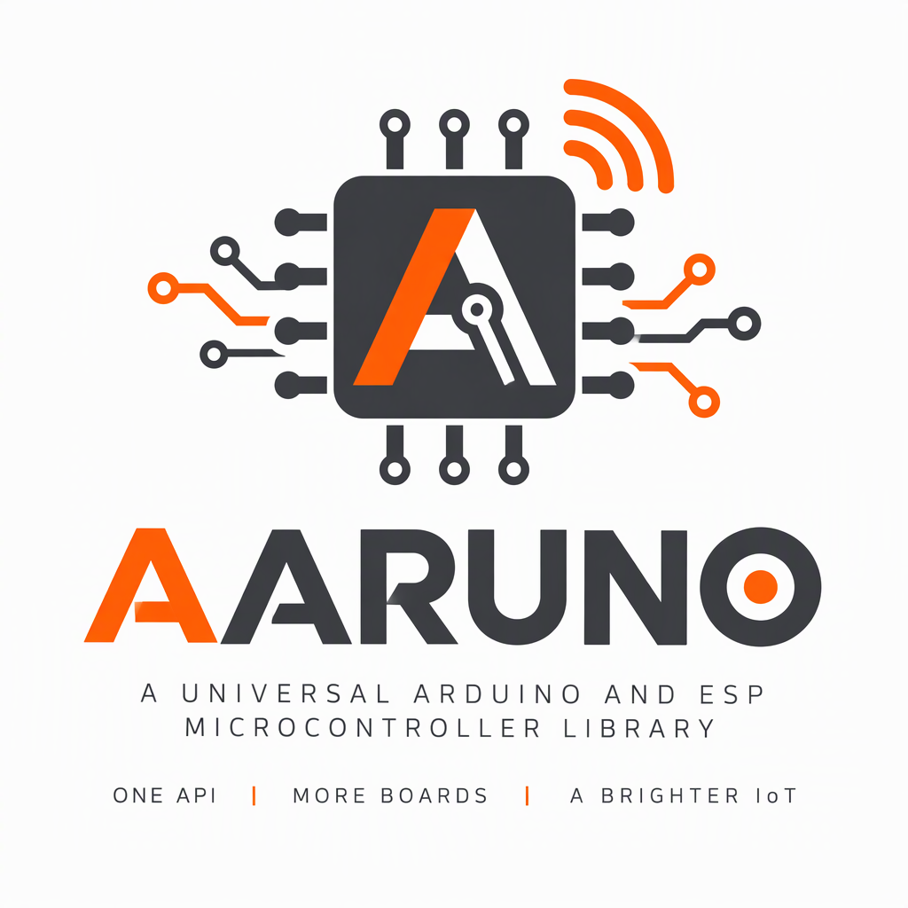

<div align="center">



# AARUNO

### Universal Arduino & ESP Library — One API for All Your Microcontroller Projects

[]()
[](LICENSE)
[]()

**Made by [AARUTO](https://github.com/AARUTO347)**

[Quick Start](#-quick-start) • [Installation](#-installation) • [API](#-api) • [Documentation](#-documentation)

</div>

---

## About

AARUNO provides **one consistent API** for ultrasonic, DHT11/DHT22, LDR, buttons, PIR, LED, buzzer, relay, motor, servo, OLED/LCD, and ESP WiFi across all popular Arduino and ESP boards.

## Supported Boards

| Board | Architecture | Voltage |
|-------|:-----------:|:-------:|
| Arduino Uno R3 | ATmega328P | 5V |
| Arduino Uno R4 Minima | RA4M1 | 5V |
| Arduino Uno R4 WiFi | RA4M1 + ESP32-S3 | 5V |
| ESP32 Family | Xtensa/RISC-V | 3.3V |
| ESP8266 (NodeMCU, Wemos D1 mini) | Xtensa | 3.3V |

> **Core has no mandatory third-party dependencies.** Displays, DHT, and Servo are optional.

## Installation

### Arduino IDE (.zip)

1. Download this repo as `.zip` (Code → Download ZIP) or use release `AARUNO-1.1.1.zip`
2. Arduino IDE → **Sketch** → **Include Library** → **Add .ZIP Library** → select the file
3. Verify: **File** → **Examples** → **AARUNO** → **Basic**

### Arduino CLI

```bash
arduino-cli lib install --zip-path AARUNO-1.1.1.zip

# Optional dependencies (only if you use those modules):
arduino-cli lib install "DHT sensor library" "Adafruit Unified Sensor"
arduino-cli lib install "Adafruit SSD1306" "Adafruit GFX Library"
arduino-cli lib install "LiquidCrystal I2C"
```

### Library Manager

Add AARUNO directly from the Arduino IDE Library Manager:

1. Arduino IDE → **File** → **Preferences**
2. In **Additional Boards Manager URLs** (or **Additional Libraries Manager URLs**), add:
   ```
   https://raw.githubusercontent.com/AARUTO347/AARUNO/docs/site/library-index.json
   ```
3. Arduino IDE → **Sketch** → **Include Library** → **Manage Libraries...**
4. Search for **AARUNO** and click **Install**


## Quick Start

```cpp
#include <AARUNO.h>

void setup() {
  AARUNO.begin();
  AARUNO.ultrasonic(7, 8);         // Uno pins; ESP32 e.g. (5, 18)
  AARUNO.lcdI2C(0x27, 16, 2);     // I2C LCD (needs LiquidCrystal I2C)
  AARUNO.led(13);
  AARUNO.buzzer(9);
}

void loop() {
  AARUNO.update();
  float cm = AARUNO.readUltrasonic();
  if (AARUNO.lastError() != AARUNO_OK) return;  // timeout / not configured
  
  if (cm > 0 && cm < 20) {
    AARUNO.setLED(true);
    AARUNO.beep(2000, 100);
    AARUNO.clearError();
    AARUNO.displayText("Close!");
  } else {
    AARUNO.setLED(false);
  }
}
```

### Board-Specific Aliases

```cpp
AARUNO.begin();
ultrasonicarduino(7, 8);
float cm = ultrasonicarduino();
```

## API Reference

| Component | Setup | Read/Write |
|-----------|-------|------------|
| Ultrasonic | `AARUNO.ultrasonic(trig, echo)` | `readUltrasonic()` → cm |
| DHT11/22 | `AARUNO.dht11(pin)` | `readTemperature()` / `readHumidity()` |
| LDR | `AARUNO.ldr(pin)` | `readLDR()` |
| Button | `AARUNO.button(pin)` | `buttonPressed()` |
| PIR | `AARUNO.pir(pin)` | `readPIR()` |
| LED | `AARUNO.led(pin)` | `setLED()` / `setBrightness()` |
| Buzzer | `AARUNO.buzzer(pin)` | `beep(freq, duration)` |
| Relay | `AARUNO.relay(pin, activeHigh)` | `setRelay()` |
| WiFi (ESP) | `AARUNO.wifiStart(ssid, pass)` | `wifiState()` / `wifiConnected()` |
| HTTP (ESP) | `AARUNO.httpGet(url, Serial)` | `httpLastStatusCode()` |
| Error | — | `lastError()` / `errorString()` |

### Error Handling

Failures return:
- `NaN` (float), `-1` (int), or `false` (bool)
- Error code in `lastError()`
- Zero is never used as a generic failure for distance

### Singleton Scope

The global `AARUNO` object holds **one of each peripheral** (one ultrasonic, one DHT, one button, one servo). For multiple sensors of the same type, use the independent classes directly (e.g., `AarunoUltrasonic`).

## Safety Warnings

> **Voltage:** ESP32/ESP8266 GPIO is **3.3V, not 5V tolerant**. HC-SR04 echo is 5V — use a voltage divider (e.g. 1k/2k) or level shifter. Software cannot fix wiring.

> **Current:** Never drive motors, relays, servos, or high-current loads directly from GPIO. Use driver modules + external power.

> **Relays:** Can be active-HIGH or active-LOW: `AARUNO.relay(pin, activeHigh)`.

## Documentation

| Document | Description |
|----------|-------------|
| [API Reference](docs/api-reference.md) | Full function list, units, error codes |
| [Board Compatibility](docs/board-compatibility.md) | Compatibility matrix for all boards |
| [Pin Reference](docs/pin-reference.md) | Safe pin assignments per board |
| [Wiring Guide](docs/wiring-guide.md) | Wiring diagrams and voltage divider circuits |
| [Troubleshooting](docs/troubleshooting.md) | Common failures and solutions |
| [Architecture](docs/architecture.md) | Internal design |
| [Adding a Driver](docs/adding-a-driver.md) | How to extend the library |

## License

**MIT** — see [LICENSE](LICENSE).

---

<div align="center">

**AARUNO v1.1.1** — Made by [AARUTO](https://github.com/AARUTO347)

[GitHub](https://github.com/AARUTO347/AARUNO) • [Releases](https://github.com/AARUTO347/AARUNO/releases) • [Issues](https://github.com/AARUTO347/AARUNO/issues)

</div>
